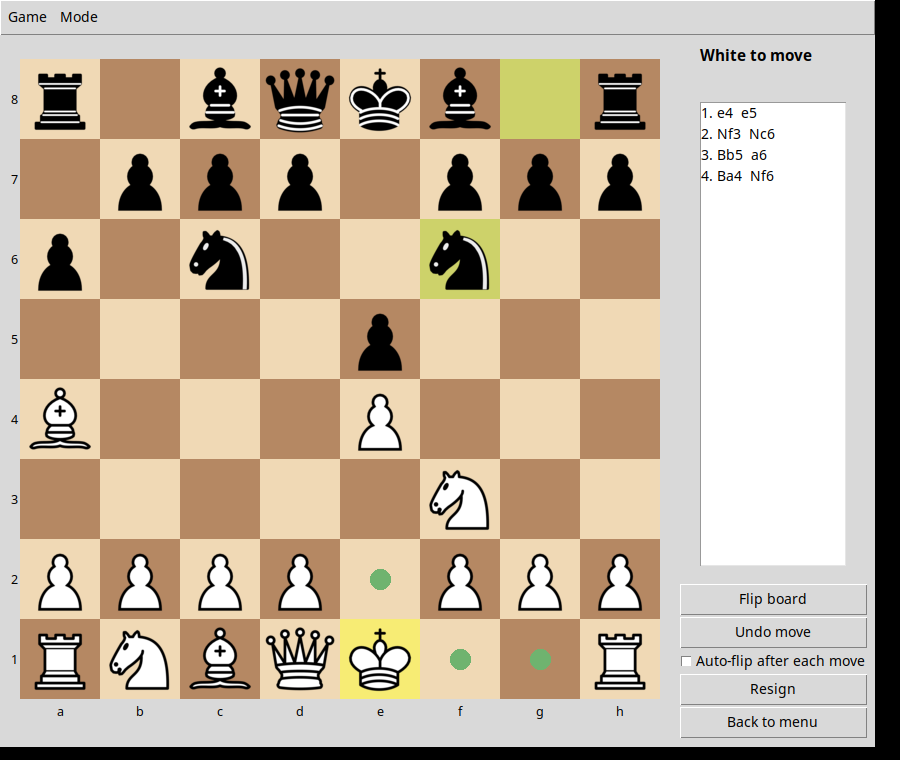

# rik-chess-master

A desktop chess app in Python with a Tkinter board and four ways to play. Games are saved as
standard PGN. Runs on macOS and Linux with one command.



## Quick start

```bash
make setup   # uv sync: creates .venv and installs dependencies
make stockfish  # optional: installs Stockfish for the Master level (apt/dnf/pacman/brew)
make run     # launches the app
make test    # hermetic: no network, no Stockfish needed
```

Requires Python 3.12 with Tkinter (on Debian/Ubuntu: `sudo apt install python3-tk`) and
[uv](https://docs.astral.sh/uv/).

**Stockfish (Master level).** Without it, Master falls back to Club and the app shows a warning.
Install with `make stockfish`, or by hand: `sudo apt install stockfish` (Debian/Ubuntu),
`brew install stockfish` (macOS), or download from <https://stockfishchess.org/download/> and set
`RCM_STOCKFISH=/path/to/stockfish`.

## Optional: Explain last move (Claude)

The **Explain last move** button asks Claude to describe the last move in plain language.
Stockfish/Club still pick every move; the position is sent to the Anthropic API only when you
click. Create `~/.config/rik-chess-master/anthropic.env` (see `docs/anthropic.env.example`):

```
ANTHROPIC_API_KEY=sk-ant-...
ANTHROPIC_MODEL=claude-sonnet-5-5
```

Keep it `chmod 600`. The same variable names in the environment take precedence, and
`RCM_CONFIG_DIR` moves the folder. Without a key the button shows setup instructions.

## Modes

| Mode | What it does |
| --- | --- |
| Tutorial | 21 guided lessons from `lessons/*.yaml`: piece basics, special rules, 5 openings, 5 tactics themes (5 puzzles each). Progress in `~/.rik-chess-master/progress.json`. |
| Famous Games | Replay six classics from `games/*.pgn` with auto-play, step, pause and commentary. Drop any PGN into `games/` and it shows up. |
| Two Player | Local (shared screen, optional auto-flip) or remote through a room-code relay over WebSocket. Offer a draw, resign, request a takeback. |
| Play vs Machine | Beginner (random, prefers captures), Club (alpha-beta minimax, depth 3), Master (Stockfish via UCI; `make stockfish` installs it; otherwise falls back to Club with a warning dialog). Hint button included. |

Games autosave to `~/.rik-chess-master/autosave.pgn` after every move; on startup the app
offers to resume an unfinished game. Saving never overwrites a file without asking.

## Remote play

Remote games go through a tiny relay (`rcm-relay`) that pairs a host and a guest by 6-character
room code and forwards messages without interpreting them.

* **Same network, no server:** in *Two Player (remote)* tick "Host on this machine". Your
  opponent enters `ws://<your-ip>:<port>` (shown in a dialog) and the room code.
* **Across the internet:** run the relay somewhere reachable, see [docs/relay.md](docs/relay.md),
  and set `RCM_RELAY_URL` (or `relay_url` in `~/.rik-chess-master/config.json`).

If the connection drops, both sides keep the game autosaved. The guest can re-join the same room
(*Reconnect*), or the host can resume from the saved PGN in a new room.

## Layout

```
src/rcm/core       Game (python-chess wrapper), PGN read/write with RCM_* tags
src/rcm/engine     RandomEngine, MinimaxEngine, UciEngine, worker thread
src/rcm/net        relay server + client
src/rcm/modes      Session classes: local, machine, remote, replay
src/rcm/tutorial   lesson loader, runner, progress
src/rcm/ui         Tkinter board, frames, app
lessons/ games/ assets/pieces/ tests/
```

The UI never touches rules: it asks `Game` for legal moves and renders the result. Network,
engine and replay all feed moves through the same `Session`/`Game` path.

## Make targets

| Target | Does |
| --- | --- |
| `make setup` | `uv sync` |
| `make stockfish` | install Stockfish (needs sudo on Linux) |
| `make run` | launch the app |
| `make test` | all tests except slow perft (UI tests skip without a display) |
| `make test-fast` | core tests only (about 1 s) |
| `make perft` | deep perft: start position depth 4-5 and Kiwipete depth 4 |
| `make lint` / `make fmt` | ruff check and format |
| `make relay` | run the relay on `127.0.0.1:8790` |
| `make clean` | remove `.venv`, caches and the autosave |

## Credits

Piece images: Cburnett set by Colin M.L. Burnett (CC BY-SA 3.0 / GFDL / GPLv2+), via the SVGs
bundled with python-chess. See `assets/pieces/README.md`. Famous-game commentary was drafted
for this project and can be edited freely in the PGN files.
